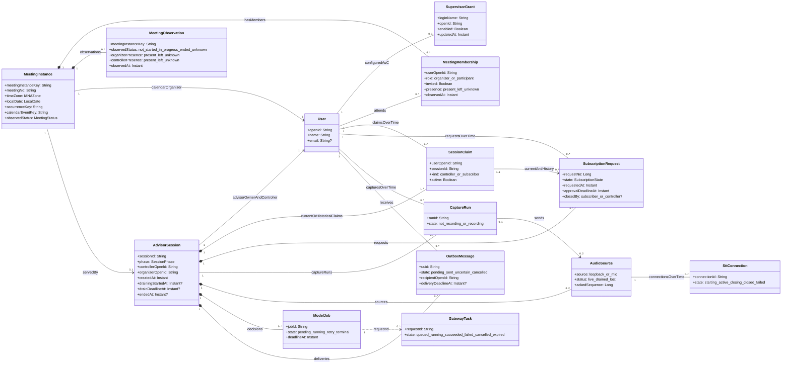

# 会参谋 Domain Model · UML 类图草案 v2

> 2026-11-16。与 [服务状态机草案](SERVICE_STATE_MACHINES_V2.md) 配套，**非数据库建表图，也非现有实现**。实线表示业务关联/归属，虚线表示仅以契约引用的跨服务对象；类名用英文便于对照代码，中文释义及约束见图下。小A/小C是飞书 Context 的角色，session owner 是会参谋 Context 的角色；C 是配置的启动能力，**不是与 A/B 互斥的用户类型**。

## 类的边界与约束

| # | 约束（草案） | 放在哪个领域边界执行 |
|---|---|---|
| I1 | `MeetingInstance` 按**会议号 + 会议时区 + 当地日期 + 当日场次**唯一；同号跨天或同日不同场次是不同实例。时区/日期须来自同一权威日历 occurrence（不能随 A/C 的展示时区变），场次绑定其稳定 ID 或固定排期开始时刻，不按请求顺序计数。每实例**整场始终最多 1 个 AdvisorSession（含历史 ended）**。 | advisor 持久化唯一键与原子抢占；验证改期、跨时区、跨日和重复日历事件的归一化规则 |
| I2 | 小A/小C 是飞书 Context 身份；session 只有 **1 个 advisor owner / controller**：合资格 A 或名单内且在该场邀请名单的 C，谁先成功创建谁拥有。该 owner 审批订阅、收默认回答、使用自身查询凭据；**已确认在会后离会 → paused、同一 owner 回会 → running**。日历组织者若不是 owner，其进出不改 phase，且**不能订阅或接手该 session**。owner 创建时尚未入会不能直接算“离会”。一个人不能在同一 session 同时扮演 owner 和 subscriber。 | advisor 准入/审批/通知/身份与查询凭据；只有 owner 的在会观测驱动暂停/恢复 |
| I3 | `SupervisorGrant.loginName` 以 `kai.han` 形式由 admin 配置，须解析到惟一稳定 `User.openId` 才生效；名单内 C 必须属于**该场日历邀请名单**（或本人是组织者），不要求在创建 session 时已进入实时会议。 | admin 写入/advisor 鉴权；可考虑保存原始录入值和解析时间作审计 |
| I4 | 同一 `User` 在任一时刻最多 **1 条 active SessionClaim**，不论 kind=controller/subscriber；历史 claim 与订阅申请可多条。**以非 ended 会话为范围、requested 即占位**；denied/本人退订/审批超时释放，session paused/draining 时已存在的归属仍占位，ended 后全部释放。 | advisor 原子事务与唯一约束；不是 bot 端内存检查 |
| I5 | 每个会话同一用户至多 1 个当前订阅；再次申请创建新 `SubscriptionRequest`（新 requestNo），不恢复终态旧行。`subscriber_cancelled` 或审批 `expired` 可以再申请，**必须重新审批**；`owner_revoked` 是否封禁再申请待确认。审批等待须有持久化 deadline，避免 requested 永久占位；仅 `approved` 的收件人进入新回答 fan-out。 | advisor 订阅域与 outbox 同事务；旧行仍可审计 |
| I6 | `CaptureRun.state` 只有 `not_recording`/`recording` 两个用户可见值；一个采集运行绑定**一个 session**和执行用户。session 建成即 `running`，即使飞书会议尚未开始也允许音频进入；GUI 停录仅使其回 `not_recording`，不使 session `paused`。可在连续 900 秒无上行到期前选择同一 `running` session 重开；到期转 `draining` 后不得再开。`paused/draining/ended` 暂不接收新音频。当前基线每 `(session, source)` 仅 1 条活连接。 | GUI/recorder + advisor ingest 准入；`source_conflict` 拒绝冲突 |
| I7 | `AudioSource.drained` 是**一次流输入结束**；`AdvisorSession.draining` 是**会话排空中**。同一 session 可多次开停采集，实施时须验收源/片段新纪元的序列号、去重与最终排空；`stream_end` 结束一次采集不等于 session ended。STT 识别连接为进程内短生命周期，不持有会议资格。 | advisor 源管理与 STT WS 边界 |
| I8 | `GatewayTask` 由 llm-gateway 持久化，advisor 仅凭 requestId 关联；outbox 属 advisor，bot 仅传输。`User.email/loginName` 只用于查找和展示，跨服务主键统一 openId。 | advisor/gateway/bot/auth 的现有契约边界 |
| I9 | **所有重要操作必须有有限 deadline 和到期动作**。session 进入 `draining` 时持久化不可因重试/重启重置的 `drainDeadlineAt`；源释放、模型 job、IM 投递的剩余等待均不得超过该总预算。订阅审批、正常运行时 pending 回答也要独立到期。到期取消确定未执行的 pending，结果未知记 `uncertain`，不可伪造成功；落实后才 `ended` 并释放用户占位。具体秒数除无音频 900 秒外待配置。 | advisor 为全局排空截止时间的事实来源；stt/gateway/bot 各自还要限定单次调用、重试和资源释放 |

### 一人一会的具体例子

- C 已在会议 M1 的 session S1 获批准订阅 → 存在 `SessionClaim(C,S1,subscriber,active=true)`；C 再请求发起 M2/S2，必须拒绝，**即使 C 是 M2 的日历组织者**。
- C 主动退订 S1 → 旧 `SubscriptionRequest` 留存 `subscriber_cancelled`；释放 claim 后可申请 M2，也可向 S1 重新发**新**申请（若 S1 仍允许订阅）；S1 owner 必须重新审批。
- A 正在控制 M1 的 S1 → A 不能订阅 M2/S2；B 对 M1 的申请 requested 时已经占用唯一名额。
- 会议 M1 已 ended → 历史 `MeetingInstance → AdvisorSession` 仍为 1:1，人员占位释放；同号下一次会议只有在当地日期或当日场次不同、取得不同 `meetingInstanceKey` 时才能新建 S2。

## 与现有结构的差距

当前 `sessions` 主要以 `owner_open_id + meeting_no` 识别，缺一次会议实例的稳定唯一键、独立的飞书组织者/参与者与 advisor owner 关系、以及跨 session 的用户归属唯一记录；`subscriptions` 的 revoked 不区分发起人；GUI 列表只按 owner 查会话。上述类图是**概念模型**：`SessionClaim` 可以实现为独立表或安全的派生约束，但必须有事务性占位机制，不能仅靠查询后插入。`MeetingObservation` 表示后续可主动查询得到的当前会议/人员状态快照，**不决定 session 从创建进入 running**；当前日历校验不足以证明 owner 实时离会/回会，也不能假设现有 OAuth scopes 足以查询人员在会情况（见 TODO.md T12）。
