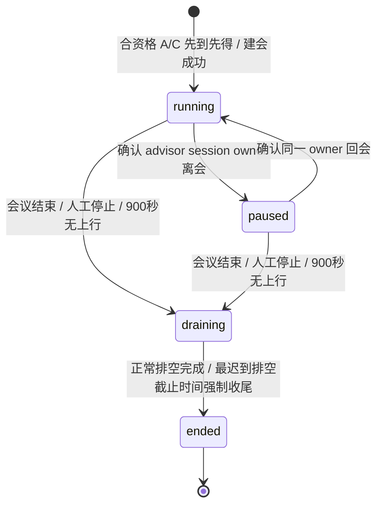
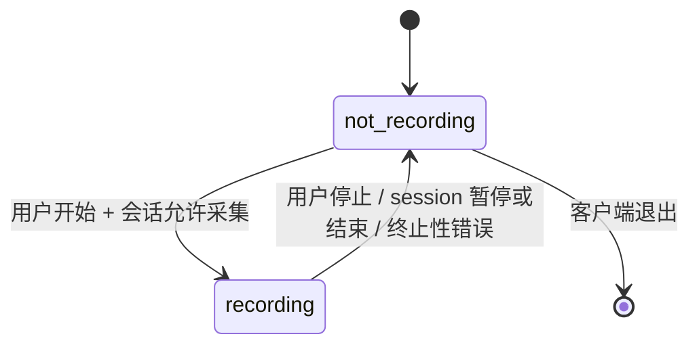
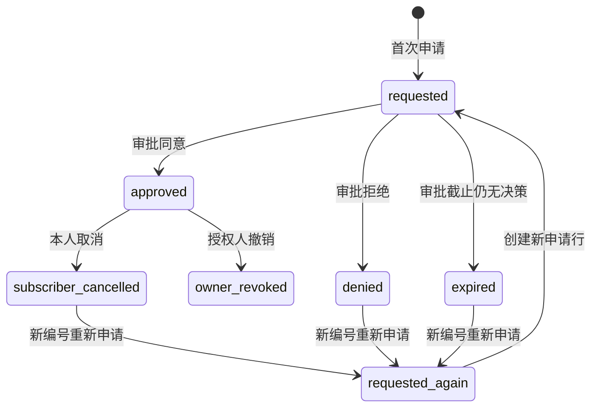

# 服务状态机 · 业务讨论后草案 v2

> 2026-11-16。基于新增小C、单会议/单人归属和可重复订阅的业务输入及后续澄清。**设计稿，尚未改现行冻结契约或代码。**配套领域类图见 [DOMAIN_MODEL_V2](DOMAIN_MODEL_V2.md)。`running` 只表示**会参谋已就绪、允许采集**，不表示飞书会议已开始、GUI 正在录音或 STT/模型服务健康。

## 0. 开始建模前：遗漏、歧义与本稿处理

| 议题 | 对现有行为的影响 | 已确认口径或剩余待定点 |
|---|---|---|
| `started` 的入口、何时到 `running` | 当前建会即 recording；此前草案把会参谋运行与飞书开会混为一谈 | **已确认**：删除 `started`；建会成功即 `running`＝就绪/允许采集，飞书会议起止是另一维度，不能反向定义 `running` |
| 谁的离会触发 paused | 飞书角色 A/C 与 advisor owner 混淆会让同场组织者和 C 的离会互相干扰 | **已确认**：唯一 advisor session owner（A 或 C，先到先得）离会 → paused；该 owner 回来 → running。日历组织者不是该 session owner 时其进出**不影响** phase |
| `drained` 是排空中还是已排空 | 原文笔误 | **已确认**：统一用现有 `draining → ended`；源状态 `drained` 保持原意 |
| 飞书实时会议状态、成员进出从哪里来 | 当前只读日历事件/时间窗，不知道人员是否在会或会议已结束 | **后续优先验证**：主动查询能力见根目录 TODO.md T12；没查到 ≠ 确认离开/结束。此问题不阻塞本稿其余业务规则的决策 |
| 一个会议“最多一个 session 存在”的时间范围 | 现行允许旧会话结束后再建新会话 | **已确认**：每场会议最多一个 session（含历史 ended）；同一 9 位号跨天复用，以**会议号 + 会议时区 + 当地日期 + 当日场次**区分 |
| “用户只能在一个 session 出现”的范围 | 是否含 requested/denied、ended 历史、及 A/C/B 同一人的角色重叠 | **已确认**：以非 ended 会话为范围，申请 requested 即预占；denied/自退订释放，历史不阻止未来会议 |
| 主动停止与自动结束 | 会未结束时人工停止能否重新开启？一次会议最多一个 session 与不可复活冲突 | **已确认**：人工结束直接进 `draining` 后 `ended`，不可重建/复活；接受误点导致该场无法继续辅助 |
| 采集停录与 session 暂停 | GUI/recorder 停录是一段无上行，不等于 owner 离会 | **已确认**：GUI 停录后可选择同一尚处于 `running` 的 session 再采集；连续 900 秒无上行则转 `draining`。`paused` 只由 owner 离会触发，采集按钮不直接改变 session phase |
| owner 离会后在途字幕/任务/回答 | 需要约定暂停边界和终止时限 | **已确认容许两种方案**：立即作废，或处理完当前在途工作后停；选实现成本较低且有界的方案。是否允许已经发送的回答继续送达不能靠“作废”撤回 |
| 小B取消后重订与撤销 | 现行 revoked 终态且重订拒绝 | 区分 `subscriber_cancelled` 与 `owner_revoked`；前者可新建申请，后者暂仍禁止；不是将同一申请行复活 |
| 谁拥有会话/谁审批/谁接收回答 | 飞书 Context 的小A/小C与会参谋 Context 的 session owner 是不同概念 | **已确认**：合资格 A/C 谁先成功建会谁是 advisor session owner，负责审批订阅、收默认回答、用自己的查询凭据；离会/回会规则也只针对这个 owner |

上表标为「已确认」的是业务口径，不代表已验证飞书 API 或完成实现；其余「暂定」仍不能直接据此落地。

## 1. 各服务拥有的状态（避免混成一个大状态机）

| 服务 / 状态所有者 | 业务状态 | 技术运行态与责任边界 |
|---|---|---|
| advisor | session phase；session 参与者归属/控制者；订阅申请；源与字幕；模型 job；outbox | 唯一裁决会话迁移、查询结果时效检查、跨 session 唯一约束；查询故障不能伪造成会议结束 |
| GUI / recorder | 用户可见 `not_recording ↔ recording`（用户原话 `not record`） | 断线重连、停止中/失败是内部子态，不是第三种录音业务状态；其采集态不得反推会议 phase |
| stt-server | 无会议业务 phase；每 WS 一识别会话 | start/active/closing/closed/failed（技术态草案）；单 WS 关闭须释放资源，不能使共享 STT 进程失效 |
| llm-gateway | 无会议业务 phase；任务 `queued/running/succeeded/failed/cancelled/expired` | advisor 按会话 phase 决定提交/采用结果；gateway 不决定会议是否结束 |
| bot | 无独立会议/订阅事实 | 解析指令、回执、拉取并投递 advisor outbox；在线/离线和发送异常只影响控制/通知通道 |
| admin-site | 无独立会议业务事实 | 配置小C名单、查看/停止会话（**拟议能力**）；配置必须在服务端持久化，不能只靠浏览器本地存储 |

## 2. Advisor session 生命周期

目标态：`running ↔ paused → draining → ended`；`running` 也可直接进入 `draining`，`ended` 终态。小A/小C是飞书会议 Context 的角色：小A是日历组织者，小C是受 admin 授权的邀请参与者或组织者；**advisor session owner** 属于会参谋 Context，A/C 中谁先成功建会就由谁担任，之后归属不随飞书组织者加入而转移。C 是 owner 时，日历组织者不能另建同场 session，也不作为 C 的订阅者或接管采集/审批。飞书会议是否开始、owner 是否在会、GUI 是否录音是三个独立事实。会议尚未开始但 session 已就绪时，仍为 `running`，可以接收音频；即使实际没有可用语音，也不据此改变 phase。

| 当前 phase | 事件 | 目标 phase | 守卫 / 幂等 / 副作用（草案） |
|---|---|---|---|
| 无 | 合资格 A 或名单内 C 入会 | `running` | A 是日历组织者、C 在邀请名单（或本人是组织者）；校验 `meetingInstanceKey` 一生唯一、用户当前归属唯一，原子抢占并写库，首位成功者是不可随意转移的 session owner |
| `running` | 查询确认该 session owner 原先在会、现在离会 | `paused` | 不以组织者身份代替 owner；创建时未入会、在会未知、API 暂不可达/音频中断/GUI 停录均不算“离会”；音频与在途任务处置另议 |
| `paused` | 查询确认**同一** session owner 回会 | `running` | 沿用同一 session、订阅与上下文；GUI 是否自动重启采集待定 |
| `running/paused` | 连续 900 秒无上行音频 | `draining` | 与飞书会议是否已开始、GUI 曾否采集无关；空闲窗内停录再开同一 `running` session 可续用；owner 离会过久也会结束本场辅助，超时后不可复活 |
| `running/paused` | 查询确认会议已结束或 session owner / admin 人工结束 | `draining` | 拒新源、新订阅、新模型任务；有界收尾；误结束不可逆，重复终止命令回显当前状态 |
| `draining` | 正常排空完成 | `ended` | 源终态（已冲刷/已丢失）、模型任务终态/过期、outbox 无 pending；uncertain 仍需人工处理 |
| `draining` | 排空截止时间到达，仍有未完成项 | `ended` | 强制关闭/标记无法完成的源；将本地未完成 job 终态化、停止等待 gateway 并丢弃迟到结果；尚未开始发送的 pending 回答取消，在途发送结果不明则记 uncertain；记录未完成原因与数量后最终置 ended。不能无限等待 bot/STT/gateway |
| `draining/ended` | 迟到的查询快照/音频/字幕/模型结果 | 不变 | 查询快照时效/版本校验；不复活 session，不应用 ended 后结果 |

**观测与空闲**：建会不再等待会议开始/音频；查询会议当前状态和 owner 在会情况用于后续暂停/结束联动，能力验证列于 TODO.md T12。只有**已确认**的 owner 离会/回会才能切 `paused/running`；查询失败保留「未知」，不能伪造离会/结束。`running` 即使在会议开始前也能持续一段无音频时间，但**任一非终态连续 900 秒无上行**就进 `draining`（首次从建会起计，最后一次真实音频上行重置；心跳不算音频）。`paused` 不冻结计时，owner 在 900 秒内回会可恢复；已进入 draining/ended 不允许靠重开 GUI 采集恢复。

**已确认的收尾原则**：所有重要操作有有限超时；`draining` 不是“等到下游恢复”为止。进入 `draining` 时持久化 `draining_started_at` 和绝对 `drain_deadline_at`（具体时长为待定配置项）；正常排空可提前 ended，到期必须在清理/记录后 ended。advisor 重启只恢复剩余预算，不重置截止时间；任何单项任务剩余等待不得超过整个 session 的剩余排空预算。到期为未完成结果留诊断记录，而不是伪造 `sent`、`drained` 或已完成模型结果。

## 3. GUI / recorder 与源 / STT 的并行状态

`not_recording` 对应用户所说的 `not record`；停止中、重连中、STT 不可用属于 UI 细节/故障诊断子态。GUI 本地 `recording` 不意味着飞书会议已开始，需持续校验 advisor phase。用户点「暂停采集」只让 GUI/recorder 从 `recording → not_recording`，并**不**令 advisor session 变 `paused`；再点「开始采集」仍选择同一 session，只要它还在 `running` 且距上次音频未满 900 秒。首次开录前则从建会计时。停录超过 900 秒后 session 进入 `draining`，GUI 应禁用再开；owner 离会导致 session `paused` 时暂定 GUI 停传或 advisor 拒收，owner 回会后是否自动开录未定，初稿倾向用户再次确认。CLI recorder 也需要明确暂停错误码和重试规则。

源状态仍按旧契约区分 `live/drained/lost`；**源 drained ≠ session draining**。这不是业务状态机缺项，而是音频接入契约的实现细节：GUI 手工停录用现有 `stream_end` 时会将本源标为 `drained`，但 900 秒窗内还允许对同一 session 再次采集；现有 ingest 部分新纪元路径能重置源行。实施时要检验连续多次停录/重开是否正确维护新纪元、序列号、字幕去重及最终排空，不能把单次片段结束误当成 session 永久结束。owner 离会导致 `paused` 时 STT 仅释放本 session 的连接，其他会议继续工作。`ack` 只表明输入已接收/持久化，不承诺有字幕；原始 STT 进程崩溃现象需独立复现与修复。

## 4. 订阅、身份与用户归属

小C 是**可启动能力**（admin 中以 `kai.han` 形式配置的名单），不是飞书会议的主持人身份；A/B/C 不是三个互斥的账号类型。同一个用户可能是某会议的组织者、另一会议的受邀参与者，同时是全局名单内 C；其在 advisor 的单 session 归属仍应受唯一约束。C 的准入以**日历邀请名单**（或本人组织者）证明参与资格，不要求已实时进入会议。应把 `kai.han` 解析为稳定的飞书 `open_id`，不能用展示名作权限主键；匹配不到/多匹配应拒绝或待人工处理，移除名单后的已启动 session 如何处理待定。

| 当前申请状态 | 事件 | 结果（草案） | 唯一归属 / 分发 |
|---|---|---|---|
| 无 | B 或 C 申请 | 新行 `requested` | 申请即预占当前 session；同人同时申请另一场拒绝 |
| `requested` | 有审批权者同意/拒绝 | `approved` / `denied` | 批准后仅从下一条回答起分发；拒绝释放预占 |
| `requested` | 审批等待 deadline 到期且仍无决策 | `expired`（建议新状态） | 释放申请即占用的单 session 名额；过期审批不再能生效；再次申请走新 request_no、新审批 |
| `approved` | 订阅者主动取消 | 旧行 `subscriber_cancelled`（建议新状态） | 取消 pending 投递并释放归属；同会议再申请**新行** `requested`，**按首次流程重新审批** |
| `approved` | 有审批权者撤销 | `owner_revoked`（建议新状态） | 即时止发；是否永远禁止该用户重申请仍待确认，暂按旧规则禁止 |
| `denied` / `subscriber_cancelled` / `expired` | 同人重新申请 | 新行 `requested` | 不回溯旧回答；新 request_no，新审批 |
| `requested/approved` | 会话结束 | 历史记录保留，归属释放 | 结束后的审批请求如何告知、pending 投递如何收尾待确认 |

这里的 `subscriber_cancelled / owner_revoked / expired` 是**草案状态**；前两者也可保留 `revoked` 并用不可变 `revoked_by` 区分，但**绝不能**让同一旧申请行从终态跳回 requested。若取消的是 `requested`，初稿建议可撤回并释放预占，具体 API/状态另议。按已确认的**非 ended 会话当前占位**约束执行，历史照留。一个会话的 controller 不应再以 subscriber 身份申请自己，避免双重通知。审批 TTL 的具体时长未定，业务若希望过期仍能批准，必须重新界定占位冲突。

图中 `requested_again` **只是跨申请行的操作示意，不是数据库状态**；一条申请行的 `denied/subscriber_cancelled/owner_revoked/expired` 都不逆向迁移。

## 5. 依赖服务遇到暂停/结束时做什么

| 触发 | advisor / ingest | STT | gateway / 模型 job | bot / outbox |
|---|---|---|---|---|
| session `paused`（owner 离会） | 暂拒新音频（错误码与令牌处理待定）；保留已完成的会话事实 | 只关闭本会话当前流，其他会话继续 | 不启动新任务；在途字幕/任务可选择立即作废或有限处理后停，须防止恢复时旧结果重复应用 | pending 回答可立即取消或有限发送后停；已发送/uncertain 不可伪称撤回；审批历史保留 |
| session `paused → running` | 允许新流/续流，确认 source epoch、去重和令牌 | 新开独立识别连接 | 继续新字幕判断，不重复旧结果 | 正常投递新回答；不回溯 |
| session `draining` | 拒新输入、结束已有源；到排空截止时未完成源记显式 lost/abandoned | 本会话连接有界释放，进程/其他会议不受影响 | 在途落定或到期取消/忽略；不再新建任务 | pending 在截止前送达或取消；结果不明记 uncertain，不阻塞 ended |
| session `ended` | 拒任何重连，流令牌失效 | 无会议持久状态 | 迟到结果不得应用 | 业务历史仍可查，不再产生新分发 |

gateway 任务本身的 `queued → running → succeeded/failed/cancelled → expired` 与 bot outbox `pending → sent/uncertain/cancelled` 暂沿现契约；它们不是会议 phase 的同义词。订阅批准只影响之后生成的回答。**已确认**：C 发起时 C 就是会参谋的 owner：C 审批订阅、接收默认回答，NSDP/Jira 等查询使用 C 自己的凭据；日历组织者即使后来到场也**不能订阅、不能接管**该 session 的采集/控制权或默认回答。暂停只跟踪 advisor session owner；会议组织者身份不替代会参谋 owner。

### 5.1 依赖服务各自的运行状态迁移（不会修改会议 phase）

| 状态所有者 | 迁移/动作 | 遇到暂停或终止时的边界 |
|---|---|---|
| STT 单连接（拟议运行态） | `starting → active → closing → closed`；启动失败或读写异常 → `failed → closed`，释放实例和并发槽 | paused/draining 只关**相关源连接**；STT 进程继续处理其他会话；健康检查不能只看进程 PID |
| gateway 单任务（现有） | `queued → running → succeeded/failed/cancelled`；终态保留期后 → `expired`；失败/取消/过期的同 request_id 可按契约重新排队 | advisor 不再为 paused/draining 发新任务；已发任务的取消/采用取决于会话阶段和前述待定策略 |
| bot 出站通知（advisor outbox，现有） | `pending → sent/uncertain/cancelled`；`uncertain` 人工裁决 | bot 进程掉线不改变会议 phase；重启后续发 pending，重复发送仍需幂等 |
| bot 入站命令（拟议运行态） | `received → parsed → advisor_accepted/rejected → replied`；断线/投递异常按事件 ID 或 advisor 幂等键重放 | 同一会议的重复入会必须返回同一 session 或明确冲突；不能在 bot 内存里维护跨会归属 |

### 5.2 全链路超时与到期动作（已确认原则；具体预算待实施时定）

| 重要操作 | 超时边界 / 触发 | 到期后的确定动作 |
|---|---|---|
| 入会准入（日历/邀请名单/凭据） | 单次远程调用超时 + 整次建会预算 | 准入失败并明确可重试原因，**不创建或重复创建** session；重试仍受会议实例和用户占位唯一约束 |
| 飞书会议/owner 在会查询 | 单次查询超时、快照最大可接受年龄 | 标为「未知」，不因查询失败伪造离会/回会/会议结束；后续有限退避再查（能力先由 T12 验证） |
| GUI/recorder 接入与 STT 流 | 建连、单帧等待、停止/释放各有上限 | 当前源连接报错/释放、保留可追溯缺口；不得卡住其他会话或阻塞总排空截止时间 |
| advisor→gateway 单任务 | HTTP 调用/轮询/执行总 deadline | 任务失败/到期或请求取消，记录原因；会议暂停/结束后迟到结果不应用；不得无限重排 |
| bot→飞书单条 IM | 单次发送预算与回写预算 | 明确未发送则待重试（受总预算限制）；结果未知记 `uncertain`，不盲目宣称成功或重复发送；`sent` 不可撤回 |
| 订阅申请 `requested` 等待审批 | 从申请起算的持久化审批 deadline（具体时长待定） | 逾期自动 `expired`、释放该用户的单 session 占位；迟到的同意/拒绝不能复活旧申请，新申请重新审批 |
| 回答 outbox `pending` 等待送达 | 单条回答的有效期（具体时长待定），即使 session 未结束也执行 | 过期且未开始发送则 `cancelled`；已发送结果不明为 `uncertain`，不得伪装未发；不因 bot 长期离线无限堆积 |
| session `running/paused` 无音频 | **已确认 900 秒**，跨手工停录/暂停连续计时 | 进入 `draining`；GUI/recorder 不再重连该 session |
| session `draining` 总排空 | 从 phase 迁入起算的**持久化绝对 deadline**（时长为配置项，尚未确认秒数） | 最迟到 deadline 清理源、停止等待任务；取消未开始发送的 pending，已进入投递却结果不明记 `uncertain`；落诊断记录、提交 `ended` 并释放人员占位 |

每个操作都应同时有单次调用上限和适用时的总预算；重试消耗剩余预算，不能因重启、重试或再次轮询刷新整个 session 的 deadline。必须区分「确定未执行」与「结果未知」：例如 IM 已发送但回写超时不能当作未发送取消，发送中进程崩溃后的恢复也须按结果未知处理。上述具体秒数除 900 秒外尚未定，不能将现有代码局部 timeout 等同于全链路有界。

## 6. 冲突矩阵与必改边界（当前都未实现）

| 新业务规则 | 现有基线冲突 | 受影响端 |
|---|---|---|
| 小C（参会者也能发起） | 建会只校验 organizer、owner_open_id；日历事件与实时参与者不是同一证明 | admin 配置、身份解析、advisor 准入、bot、GUI、auth 凭据 |
| 单会议最多一个 session | 只按 `(owner, meeting_no)` 找活动会话；不同 owner 可并发创建 | 会话库唯一约束、建会幂等、会议实例标识、并发抢占 |
| 单人最多一个 session 归属 | 现有无跨 session 角色/订阅限制 | controller/订阅占位事务、审批与退订、GUI 会话发现 |
| running/paused/draining/ended | 当前 recording/draining/ended，无 paused；须把 running 与飞书会议开始解耦 | STATE_MACHINES、ingest、监督器、API、GUI、bot、admin |
| owner 在会/会议结束查询联动 | 当前仅日历校验及音频空闲超时；无会议当前状态/人员进出查询能力 | TODO.md T12（后续优先验证）；周期查询与快照时效、超时策略 |
| draining 需有总排空 deadline | 现有 drain_ready 要求无 pending outbox，bot 不可用可能无限停留 draining；局部 STT/模型超时不构成总预算 | advisor 持久化 deadline、到期清理、源/job/outbox 终态与审计；bot 结果未知处理 |
| 小B退订后重订 | 现有 revoked 终态且再次申请 409 | 订阅状态/原因、API、bot 话术、fan-out、历史 |

## 7. 仍需收口的边界（业务决策与技术验证分开）

| 类型 | 场景与待定口径 |
|---|---|
| **已确认** | **人工结束不可逆**：同一场会议一生只有一个 session；接受 owner/admin 误点结束后该场无法再继续辅助。 |
| **实现选型** | **暂停期的在途工作**：owner 离会瞬间，字幕、模型任务和 pending 回答可以立即作废，也可以有界处理完再停；按实现成本选方案，必须保证迟到结果不重复应用、已发 IM 不能撤回。暂停时是否允许新申请订阅仍需明确。 |
| **业务决策** | **两态 GUI 的自动恢复**：paused 导致停录后，owner 回会是否自动重新采集？初稿建议由用户再点一次；若要自动恢复，需明确授权与采集触发条件。CLI recorder 暂停期间不应无限重试。 |
| **业务决策** | **建会后尚未入会的 owner**：创建 session 时 owner 的在会状态可能是 unknown/left；`paused` 定义为从“确认在会”到“确认离会”的转变，而不是“当前不在会”。若希望“创建时就不在会也 paused”，需要补一条不同触发规则。 |
| **业务决策** | **授权人撤销与待审批取消**：本人退订后重新申请必须重审已明确；owner 撤销是否永久阻止再申请，以及 requested 可否本人取消，仍未定。 |
| **技术验证** | **飞书实时状态**：owner 离会/回会与会议结束如何主动查询、查询失败怎么降级，已记 TODO.md T12；此项不阻塞状态和角色规则定稿，但阻塞自动联动实现。 |
| **技术验证** | **会议键字段**：已选“会议号 + 会议时区 + 当地日期 + 当日场次”；时区和日期须以**同一场会议的权威日历 occurrence** 为准，不能分别用 A/C 自己设备或日历的展示时区；场次须从稳定的 occurrence ID 或固定排期开始时刻生成，**不得按请求顺序编号**。跨日、改期/改时区、同号同日多场如何归一化为同一个键需验收。 |
| **技术验证** | **邀请名单与身份映射**：C 必须在该场日历邀请名单，需验证通过本人 OAuth 能否读取邀请参与者及将飞书 user_id/open_id 映射为同一人；仅知道会议号/已加 C 名单不足以准入。 |
| **技术验证** | **900s 规则精确化**：running/paused 连续无音频 900 秒进入 draining；现有 ingest 活动时间可能由心跳/控制消息更新，需改为“真实音频”口径、从建会起算并跨停录/暂停连续计时；旧 `(owner,meeting_no)` 去重仍可能生成多 session。 |
| **技术验证** | **暂停采集后重开同一 session**：现有 `stream_end` 把音频源标记 `drained`；两态 GUI 允许 900s 内再次开始，同 session owner 回会也可恢复。需验收同一源多段音频的新纪元序列、字幕去重与排空判定。 |
| **实施参数** | **排空总时长及各步骤预算**：业务已定必须有 timeout 和到期处理；配置的具体秒数、审批等待 TTL、回答有效期、告警阈值、暂停期任务截止时间待根据真实调用耗时与资源成本设定，不能无界等待。 |

确认上述业务问题后修订 [REQUIREMENTS](REQUIREMENTS.md)、[STATE_MACHINES](STATE_MACHINES.md) 及冻结契约（协议/API 版本、双端行为），再实施并做集成验证；本稿不覆盖当前运行语义。重点验收：同号不同日期/同日不同场次、不同用户同时抢同场、跨会抢占、owner 与飞书组织者不同时离会/回会、无音频的 running、取消后重订、paused/结束时其他会议 STT 持续可用。
