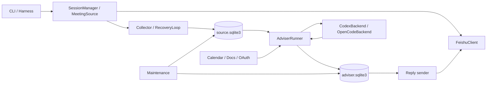
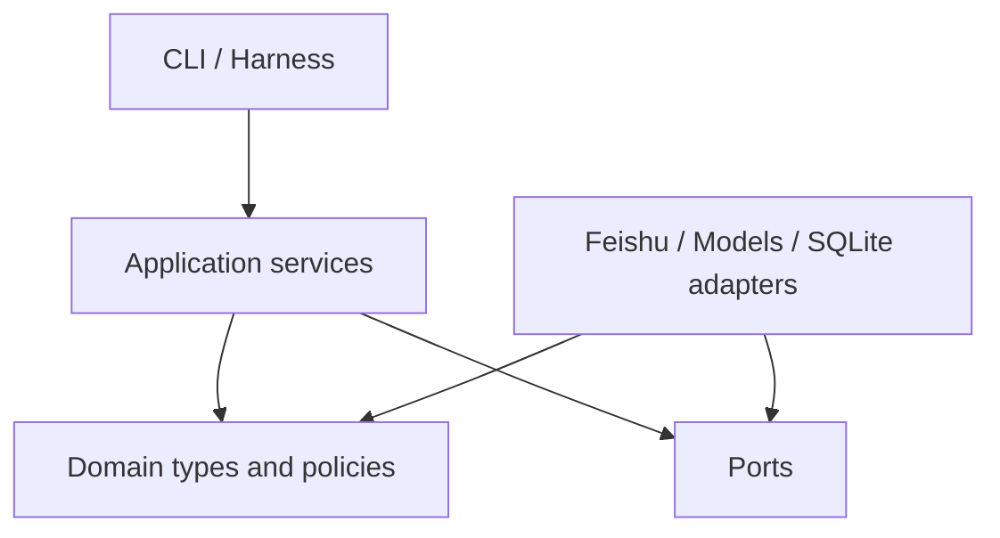

# v2 架构评审与重构建议

日期：2026-10-15。评审范围：`v2/src/feishu_meeting_adviser/`、`v2/src/meeting_adviser_harness/`、相关测试与项目配置。本文记录当前实现的架构判断和后续重构建议，不表示已经实施这些改动。

## 1. 结论摘要

`v2` 已经越过普通原型阶段。它在字幕可靠采集、幂等消费、任务恢复、发送不确定性处理、敏感数据保护和故障测试方面有比较完整的设计。当前主要问题不是功能不稳定，而是随着阶段 2 功能持续加入，业务状态、SQLite 细节、流程编排和命令行入口开始相互渗透。

如果继续在现有结构上直接增加 Word/PDF、参会者权限、更多模型后端和通知渠道，主要风险将是：

- 一项状态变化需要同时修改 Runner、SQL、CLI、恢复逻辑和测试夹具。
- 数据库字段或状态值变化可能影响多个绕过存储抽象的调用方。
- 模型任务、回复发送和材料版本三个状态机的组合数继续增长，难以靠调用顺序维持正确性。
- 只读命令、初始化和数据库迁移之间的边界不清晰。
- 单个模块承担过多职责，局部改动需要理解整条产品链路。

本次建议的核心不是大规模重写，而是保留现有可靠性语义和测试资产，按照以下顺序逐步收紧边界：

1. 建立正式的数据库迁移和公共 SQLite 基础层。
2. 将模型任务、回复发送等隐式状态机显式化。
3. 禁止业务层直接访问 `.db`，以 repository 接口封装 SQL。
4. 从 `AdviserStore` 提取上下文构造、任务和 outbox 职责。
5. 将 `AdviserRunner` 收窄为应用层编排器。
6. 最后拆分 CLI、配置解析、材料加载和 harness。

不建议把切换到 `asyncio` 作为当前重构目标。现有“同步 I/O + 单模型工作线程 + SQLite 持久化”模型容易推理，并且已积累大量恢复测试。当前收益最高的是边界和状态机重构，而不是更换并发范式。

## 2. 评审方法和验证基线

本次评审检查了：

- 产品包中约 5,600 行 Python 代码。
- CLI、配置、飞书客户端、采集、恢复、生命周期和持久化链路。
- Codex 与 OpenCode 模型后端。
- 日程材料、OAuth、诊断、清理与本地 harness。
- SQLite schema、事务和调用边界。
- 测试文件及其覆盖的故障场景。

评审时执行：

```bash
.venv/bin/python -m unittest discover -s tests -v
```

结果为 208 项测试通过，1 项按当前产品范围跳过，总耗时约 57 秒。工作区在评审开始时没有 `v2` 下的待提交修改。

这套测试是后续重构最重要的安全网。重构期间应保持现有行为测试通过，并优先补充架构边界测试，而不是先删除或重写这些集成测试。

## 3. 当前架构概览

当前运行链路可以概括为：



架构中已经存在一些正确且应该保留的边界：

- `collect` 与 `consume` 分离，模型慢或失败不阻止字幕采集。
- 源交付采用至少一次语义，下游持久化后才确认。
- 模型决定和发送结果分别持久化。
- POST 结果不确定时进入人工核对状态，不盲目重发。
- 模型后端不直接持有飞书发送权限。
- 会议正文和诊断信息分离，诊断采用白名单式字段。
- 模型使用有界上下文，并在发送前复查新鲜度和修订状态。

这些设计不是本次重构要替换的对象。重构目标是让这些可靠性规则成为更清晰的接口和状态转换，而不是继续隐含在 SQL 与调用顺序中。

## 4. 做得较好的部分

### 4.1 可靠交付语义完整

`Store` 将字幕、交付记录和检查点放在事务中提交；消费者进度独立保存。`AdviserRunner` 先将输入写入 adviser inbox，再确认源交付。确认丢失时，重复交付会被稳定 ID 吸收。

这套设计已经通过事务前后崩溃、消费确认丢失、SIGTERM/SIGKILL 和进程恢复测试验证，应作为重构的不可破坏契约。

### 4.2 对不确定外部副作用处理谨慎

回复发送使用持久化 UUID 和 `pending → sending → sent/uncertain/rejected` 语义。发生网络超时或进程中断后，不将未确认 POST 当作未发送，也不自动换 UUID 重发。

这种设计比简单重试安全，后续抽取 outbox 时必须保留。

### 4.3 安全与隐私不是事后补丁

代码对配置、数据库、OAuth 文件、诊断和材料预览的文件权限、符号链接、容量和内容泄露做了明确限制。模型工具隔离也在提交字幕前进行核验。

重构公共存储或 HTTP 层时，应保留失败闭合原则：异常信息不能包含字幕正文、凭据、路径中的敏感标识或模型原始错误输出。

### 4.4 测试覆盖了真实故障窗口

测试不仅验证成功路径，还覆盖了事务回滚、分页中断、模型在途新字幕、发送后落盘前崩溃、材料版本变化、OAuth 轮换、工具隔离和强制终止等场景。

因此建议采用渐进式重构：每次只迁移一个边界，保持现有行为测试不变，再为新接口增加单元测试。

## 5. 主要架构问题

### 5.1 两套数据库的迁移策略不一致

`storage.Store` 使用 `PRAGMA user_version` 管理 schema 版本；`AdviserStore` 则在构造函数中执行 `CREATE TABLE IF NOT EXISTS`、读取列信息和条件式 `ALTER TABLE`。

由此产生的问题：

- `AdviserStore` 没有明确、可审计的 schema 版本。
- 打开数据库、初始化 schema 和升级 schema 是同一个操作。
- `status` 等读取路径构造 `AdviserStore` 时也可能修改数据库。
- 一次升级由多个自动提交语句组成时，中途失败后的状态不够清晰。
- 后续字段增加容易继续堆叠条件式列检查。
- 多处 `INSERT ... VALUES (...)` 依赖表的列顺序，schema 演进时风险较高。

#### 建议

建立公共 SQLite 基础层和显式迁移：

```text
feishu_meeting_adviser/
  persistence/
    sqlite.py
    migrations/
      source.py
      adviser.py
    source_repository.py
    adviser_repository.py
```

`sqlite.py` 统一负责：

- 私有目录和数据库文件检查。
- 连接参数、WAL、同步级别、busy timeout 和容量上限。
- 事务上下文和 SQLite 异常归类。
- 只读连接与读写连接的区别。

迁移层负责：

- 明确记录当前 schema version。
- 按版本顺序执行小步迁移。
- 每一步具有确定的前置版本和目标版本。
- 在支持范围内使用单事务迁移。
- 对无法自动处理的旧版本给出安全、无正文的错误。

所有 INSERT 应显式写出列名，避免依赖列顺序。

### 5.2 业务状态机隐含在 SQL 和调用顺序中

当前至少存在以下状态机：

| 对象 | 主要状态 |
| --- | --- |
| 模型任务 | pending、running、complete、abandoned |
| 回复发送 | pending、sending、sent、uncertain、rejected、cancelled |
| 参与状态 | active、paused |
| 材料 | disabled、loading、ready、partial、unavailable |
| 源状态 | collecting、recovering、incomplete、action_required、stopped、ended |

源状态已经使用 `StrEnum`，但其余状态主要是散布在 SQL 中的字符串。允许哪些转换、转换时必须同时更新哪些字段，需要从多个方法和测试中推断。

#### 建议

先定义枚举，不改变数据库中的字符串值：

```python
class JobState(StrEnum):
    PENDING = "pending"
    RUNNING = "running"
    COMPLETE = "complete"
    ABANDONED = "abandoned"


class ReplyState(StrEnum):
    PENDING = "pending"
    SENDING = "sending"
    SENT = "sent"
    UNCERTAIN = "uncertain"
    REJECTED = "rejected"
    CANCELLED = "cancelled"
```

然后把状态转换集中到 repository 方法：

```python
job_repo.claim(job_id)
job_repo.complete(job_id, decision)
job_repo.fail(job_id, reason, retry_at)
job_repo.abandon(job_id, reason)

outbox.claim(message_uuid)
outbox.confirm_sent(message_uuid, sent_at)
outbox.mark_uncertain(message_uuid, reason)
outbox.reject(message_uuid, reason)
outbox.cancel(message_uuid, reason)
```

每个转换方法应：

- 在 SQL 条件中验证允许的前置状态。
- 检查受影响行数。
- 在同一事务中更新关联字段。
- 返回结构化结果，而不是要求调用方再次读取数据库推断结果。
- 对非法转换抛出固定、安全的领域错误。

repository 的拆分不能改变当前原子性。现有 `finish_job()` 会在同一 SQLite 事务内完成 job 状态、meeting 的 participation/decided generation、旧回复取消和新 outbox 写入。这是一个业务事务，而不是四个可独立提交的 repository 操作。

因此应用层需要显式共享的 `UnitOfWork`：

```python
with adviser_uow.transaction() as tx:
    job = tx.jobs.require_running(job_id)
    decision_applier.apply(
        job=job,
        meetings=tx.meetings,
        jobs=tx.jobs,
        outbox=tx.outbox,
    )
```

同一 `UnitOfWork` 中的 repositories 必须共享同一个 SQLite connection 和同一个事务。repository 方法不得自行提交；最外层应用用例决定 commit 或 rollback。模型调用和飞书发送等外部 I/O 不进入数据库事务，继续使用持久化状态衔接副作用。

### 5.3 存储抽象被上层绕过

CLI、`AdviserRunner` 和 `Maintenance` 都直接使用 `store.db.execute(...)`。这意味着数据库表结构实际上是多个上层模块的公共 API。

典型场景包括：

- CLI 直接读取 tombstone 和 conflict 表。
- Runner 直接更新材料加载状态。
- Maintenance 直接枚举 tombstone 和 adviser meetings。

#### 建议

补充以下领域化接口，并逐步禁止 persistence 包之外出现 `.db`：

```python
source_store.is_deleted(meeting_id)
source_store.list_conflicts(meeting_id, include_text=False)
source_store.deleted_identities()

adviser_store.mark_material_loading(meeting_id)
adviser_store.list_meeting_ids()
adviser_store.read_status(meeting_id)
```

可以增加静态架构测试，但第一阶段应采用 ratchet，而不是立即要求零违规：

- 扫描并记录当前 persistence 之外所有直接数据库访问和原始 SQL 位置，形成带原因的基线 allowlist。
- CI 规则为“只减不增”；新代码不能增加 allowlist 项。
- 检查范围不能只匹配 `.db.execute`，还应覆盖 `sqlite3` 导入、`execute`/`executescript` 调用和 SQL 关键字字面量，允许项仅限 persistence、迁移代码和明确的数据库测试。
- 每次迁移一个调用点就从 allowlist 删除对应项，不允许替换成另一种绕过检测的调用方式。
- 阶段 C 完成时清空产品代码中的 allowlist；测试 fixture 和迁移脚本使用独立规则管理。

### 5.4 `AdviserStore` 职责过多

`AdviserStore` 当前同时负责：

- schema 初始化和升级。
- durable inbox。
- 会议上下文表。
- 模型 snapshot 构造与预算裁剪。
- 模型 job 生命周期。
- 回复 outbox 生命周期。
- 材料快照。
- 历史清理和状态统计。

其中 `snapshot()` 是上下文选择和预算策略，不是基础数据访问；`finish_job()` 同时做证据校验、参与状态变更、旧回复取消、新回复落盘、任务压缩和会议进度推进。

#### 建议

拆成以下协作者：

```text
AdviserInboxRepository
MeetingContextRepository
ModelJobRepository
ReplyOutboxRepository
MaterialSnapshotRepository
SnapshotBuilder
DecisionApplier
```

`SnapshotBuilder` 负责：

- 查询上下文所需数据。
- 判断 fresh input。
- 组装 evidence。
- 合并 pending/sent replies 和会议材料。
- 执行上下文预算和省略策略。

`DecisionApplier` 负责：

- 校验模型引用的证据。
- 检查证据当前版本和新鲜度。
- 计算新的参与状态。
- 取消过时候选。
- 创建确定 UUID 的回复记录。
- 完成或放弃模型任务。

repository 只做数据读写，策略对象不直接暴露 SQL。

### 5.5 `AdviserRunner` 同时负责过多流程

`AdviserRunner` 当前持有：

- 会话和配置守卫。
- 材料启动加载。
- 源输入消费和确认。
- 模型工作线程。
- 模型结果持久化。
- reply dispatch。
- 维护锁和 adviser 独占锁。
- 统计与通知。
- 关闭和中断。

构造函数也包含较多可选依赖和测试回调。这是类逐渐成为应用“总管”的信号。

#### 建议

分解为：

| 组件 | 职责 |
| --- | --- |
| `MaterialBootstrapper` | 启动时加载并保存材料，处理授权主体变化 |
| `InputIngestor` | 读取源交付、持久化 inbox、确认源进度 |
| `ModelJobExecutor` | claim job、调用后端、保存成功或失败 |
| `ReplyDispatcher` | 发送前守卫、claim outbox、确认发送结果 |
| `RuntimeGuard` | 会话、配置、角色、OAuth 主体和源状态检查 |
| `AdviserService` | 按顺序编排上述组件并提供 run/step |

分解后，`AdviserService.step()` 应是容易阅读的应用流程，而不是同时包含数据库和线程细节。

### 5.6 CLI 是一个大型条件分支

产品 CLI 的 `main()` 同时负责依赖创建、信号处理、命令路由、锁、输出格式和异常到退出码的映射。每增加一个命令，都需要继续扩展同一个函数。

#### 建议

```text
cli/
  parser.py
  bootstrap.py
  errors.py
  commands/
    join.py
    leave.py
    collect.py
    consume.py
    status.py
    conflicts.py
    replies.py
    maintenance.py
```

每个 command 接收已构造的依赖或一个 `ApplicationContext`，返回结构化结果和退出码。输出 JSON/文本的选择在 CLI 边界完成，业务服务不直接 `print()`。

`main()` 最终只保留：

1. 解析参数。
2. 加载配置。
3. 构建依赖。
4. 调用对应命令。
5. 统一映射已知异常和退出码。

### 5.7 模型后端协议过窄

`ModelBackend` 目前只声明 `decide()` 和 `close()`，但 Runner 还通过 `getattr` 隐式读取 `diagnostic_metadata` 和 `context_overhead_characters`。

#### 建议

把实际需要的能力写入协议：

```python
class ModelBackend(Protocol):
    @property
    def context_overhead_characters(self) -> int: ...

    def decide(self, snapshot: ModelSnapshot, role: str) -> Decision: ...
    def diagnostics(self) -> ModelDiagnostics: ...
    def close(self) -> None: ...
```

统一的是生命周期、返回类型和诊断契约，不应为了复用而强行合并 Codex stdio RPC 与 OpenCode HTTP 的传输实现。两者协议差异较大，分别维护更清晰。

### 5.8 材料加载函数混合了多个层次

`load_materials()` 同时负责 deadline、身份选择、OAuth、日程绑定校验、引用发现、文档读取、预算、预览事件和最终快照。

#### 建议

形成显式流水线：

```text
EventLoader
  -> BindingValidator
  -> ReferenceExtractor
  -> DocumentLoader
  -> MaterialBudgeter
  -> MaterialSnapshot
```

另外，当前代码会临时修改客户端和 OAuth transport 的 `timeout`。建议 transport 接受单次请求 deadline 或 timeout，避免可变共享客户端产生隐藏状态：

```python
client.event(calendar_id, event_id, deadline=deadline)
client.document(token, deadline=deadline)
```

### 5.9 配置解析集中在一个函数

`load_config()` 同时解析和验证 app、meeting、collector、storage、HTTP、runtime、LLM 与 meeting context。新增配置时，函数会继续增长。

#### 建议

让每个配置类型负责解析自己的 section：

```python
ScanSettings.from_mapping(raw)
LLMSettings.from_mapping(raw, base_directory=...)
MeetingContextSettings.from_mapping(raw)
StorageSettings.from_mapping(raw, base_directory=...)
RuntimeSettings.from_mapping(raw)
```

顶层 `load_config()` 只负责安全读取 YAML、检查顶层结构并组合配置。当前不必引入 Pydantic；标准库 dataclass 足以满足需求，重点是拆分和统一错误信息。

### 5.10 基础设施存在循环依赖迹象

`maintenance` 导入 `lifecycle.FileLock`，而 `lifecycle` 又在工作线程中局部导入 `Maintenance`。虽然运行可行，但说明锁和维护的归属层次不清楚。

#### 建议

将通用文件锁移动到：

```text
infrastructure/file_lock.py
```

`lifecycle`、`maintenance` 和 adviser runtime 都依赖该模块，彼此不再反向导入。

### 5.11 Bootstrap 必须感知命令的读写需求

只提供只读 repository 仍不足以保证 `status` 严格只读。当前 CLI 在完成命令分派前就创建 `Store`、诊断、maintenance、飞书 client 和 manager；创建存储对象又可能执行 schema 初始化或迁移。

建议在完整 CLI 拆分前先引入最小化的 command-aware bootstrap：

```python
command = parse_command(argv)

if command.requires_migration:
    context = factory.open_and_migrate(command)
else:
    context = factory.open_readonly(command)
```

要求：

- 每个命令声明需要的资源、读写权限和锁，不构造无关依赖。
- `open_readonly()` 使用 SQLite read-only URI 或等价机制，不能建表、升级 schema 或创建数据库文件。
- `open_and_migrate()` 在明确的迁移锁保护下打开并升级数据库。
- schema 过旧且只读命令无法安全解释时，返回固定的“需要先运行迁移型命令”错误，不尝试升级，也不输出底层路径或 schema 内容。
- database/repository factory 统一传入 data directory、数据库容量和内容容量，所有入口禁止自行拼装构造参数。
- status、replies、conflicts 等命令是否真正只读应逐项定义；需要人工状态变更的命令继续走读写路径。

## 6. 已发现的具体问题

### 6.1 状态中的 backend 被固定为 Codex

`AdviserStore.status()` 在已有会议和无会议两条路径中都固定返回 `backend: codex`。当实际配置为 OpenCode 时，status 会给出错误后端信息。

建议由应用层将实际 backend 合并到状态结果，存储层只返回持久化业务状态；或者将 backend 作为显式参数传入，但不建议由 repository 猜测运行配置。

### 6.2 只读 status 可能触发 schema 写入

CLI 的 `status` 命令为了读取 adviser 状态而构造 `AdviserStore`；`AdviserStore.__init__()` 同时包含建表和列迁移。因此 status 并非严格只读。

正式迁移层建立后，应在进程启动的明确阶段执行迁移，状态查询使用只读 repository 或只读连接。

### 6.3 模型工作线程吞掉了编程错误类型

模型线程除 `ModelError` 外捕获所有 `Exception`，统一保存为 `model_failed`。这能避免敏感异常泄露，但也会把代码缺陷和外部模型失败混为一类。

建议继续对用户暴露固定错误类型，同时向脱敏诊断记录安全的异常类名，例如：

```json
{
  "kind": "model",
  "error_kind": "model_failed",
  "internal_exception_type": "TypeError"
}
```

禁止记录异常消息、模型原文或会议正文。

### 6.4 存储构造参数使用不完全一致

部分维护和状态路径构造 `AdviserStore` 时只传 `database_capacity_bytes`，没有传配置中的 `content_capacity_bytes`，因而回落到默认值。当前路径主要是查询或清理，但这种不一致会使行为依赖调用入口。

建议通过依赖构造器统一创建 repository，禁止各模块自行拼装路径和容量参数。

### 6.5 多处使用位置型 SQL INSERT

例如 adviser inbox、context 和材料表的写入依赖当前列顺序。迁移增加列后，即使测试数据库从零创建正常，升级数据库也可能暴露顺序或默认值问题。

建议所有 INSERT 明确列名，并在迁移测试中覆盖从每一个受支持旧版本升级。

## 7. 建议的目标架构

目标不是追求严格的框架式分层，而是让业务规则、应用编排和外部适配器之间形成可测试边界。

```text
feishu_meeting_adviser/
  domain/
    captions.py
    meetings.py
    model_jobs.py
    replies.py
    materials.py
    errors.py

  application/
    collect_service.py
    adviser_service.py
    material_bootstrapper.py
    snapshot_builder.py
    decision_applier.py
    reply_dispatcher.py
    maintenance_service.py

  ports/
    transcript_source.py
    model_backend.py
    meeting_api.py
    repositories.py

  adapters/
    feishu/
      client.py
      context_client.py
      oauth.py
    models/
      codex.py
      opencode.py
    persistence/
      sqlite.py
      source_repository.py
      adviser_repository.py
      migrations/

  infrastructure/
    file_lock.py
    diagnostics.py
    deadlines.py

  cli/
    parser.py
    bootstrap.py
    commands/
```

依赖方向为：



领域层不导入 SQLite、urllib、subprocess、threading 或 argparse。应用层可以管理流程和取消信号，但不写 SQL。适配层实现外部协议和持久化。

不要求一次性移动全部文件。可以先在现有包内增加这些边界，待调用方稳定后再移动模块。

## 8. 分阶段实施计划

### 阶段 A：建立重构护栏

目标：在不改业务行为的情况下，为后续迁移建立自动检查。

工作项：

1. 保留当前 208 项测试作为回归基线。
2. 在 `pyproject.toml` 中增加固定的 `dev` optional dependency group，包含 Ruff、Pyright、coverage；开发环境统一使用 `python -m pip install -e '.[dev]'`，不同时维护另一份手写开发依赖清单。
3. 固定本地与 CI 标准命令：

   ```bash
   ruff check src tests
   pyright
   coverage run -m unittest discover -s tests -v
   coverage report --show-missing
   ```

4. Ruff 首次只启用低争议错误规则，不在同一提交中做全库格式化或风格重写。
5. 在 `pyproject.toml` 中配置 Pyright 的初始 include 为 `models.py`；建立 `domain/`、`ports/` 后立即加入。阶段 B 覆盖 persistence 公共接口，阶段 C/D 覆盖 repositories 和 application services，最终再评估旧 adapters。CI 中维护明确的覆盖路径，不用大量无期限 ignore 假装全库通过。
6. coverage 用于观察关键分支和迁移后的覆盖退化，不把单一行覆盖率作为质量结论；可靠性契约必须有具名测试。
7. CI Python 矩阵固定为 3.11 和 3.14；3.11 代表项目声明的最低版本，3.14 代表当前开发验证版本。以后调整最高版本时显式修改矩阵。
8. 增加数据库边界架构测试，以当前违规点为带原因 allowlist，执行“只减不增”的 ratchet；同时检测 persistence 之外的直接数据库访问和原始 SQL。
9. 将确认时机、确定 UUID、`finish_job()` 原子更新和 uncertain 发送等关键行为标为可靠性契约测试，后续重构必须保留。

验收：`.[dev]` 可在干净环境安装；四条标准命令可重复执行；Python 3.11/3.14 CI 通过；架构 allowlist 与当前现状一致且新违规会使 CI 失败；不改变产品行为。

### 阶段 B：统一 SQLite 和迁移

目标：数据库打开、迁移、锁、bootstrap、容量和异常处理只有一套实现；只读命令在构造依赖阶段就保持只读。

开始编码前先形成迁移兼容清单：

| 数据库 | 当前状态 | 必须盘点和保留的 fixture |
| --- | --- | --- |
| source | 当前 `PRAGMA user_version=5`；现有代码识别 0–5 | `source_v1` 至 `source_v5`；version 0 需区分新空库与可能存在的未版本化历史库 |
| adviser | 当前没有正式 user version，以列探测执行条件式升级 | `adviser_legacy_base`、加入 join/role/source status 列后的历史形态、加入 material/context version 列后的当前未版本化形态 |

fixture 必须由对应历史提交/发布代码真实创建后脱敏保存，不能仅根据当前代码手写一个“看起来相同”的 DDL。盘点仓库历史后，应把每个受支持版本对应的提交、schema 摘要、fixture 文件和目标版本写入迁移测试清单。如果无法证明某个历史形态曾发布或被用户使用，可以明确排除，但不能默认为兼容。

不支持的未来版本、损坏 schema 或无法识别的未版本化形态必须失败闭合：不写数据库、不自动降级、不删除资料，返回固定的“数据库版本不受支持，需要人工检查”错误。

工作项：

1. 将 `FileLock` 提取到 `infrastructure/file_lock.py`，消除 lifecycle/maintenance 的反向依赖；保持现有锁文件、进程释放和可中断等待语义。
2. 明确定义迁移锁策略：source 与 adviser 分别需要哪个文件锁、锁顺序如何、运行中的 collect/consume 如何阻止迁移，以及异常退出后如何恢复。所有多锁路径使用同一全局顺序，避免死锁。
3. 提取 `SQLiteDatabase` 或等价基础层，统一权限、连接参数、事务、容量异常和安全错误。
4. 实现 `open_readonly()` 与 `open_and_migrate()` 两条路径；只读路径不得创建文件或执行 PRAGMA/schema 写入。
5. 引入最小化 command-aware bootstrap。参数解析后先判定命令需要的数据库、读写模式和锁，再构造依赖；尚不要求拆分全部 CLI handlers。
6. 实现统一 database/repository factory，集中传入路径、`database_capacity_bytes`、`content_capacity_bytes` 和其他存储参数。status、maintenance、replies、harness 等入口不再自行构造 `Store`/`AdviserStore`。
7. 为 source/adviser 定义独立 schema version 和迁移 runner，将 `AdviserStore` 的条件式 ALTER 转为显式迁移。
8. 所有 INSERT 改为显式列名。
9. 为兼容清单中的每个历史版本增加真实 fixture 和逐版本升级测试。
10. 增加迁移中途故障、重复执行、两个进程并发启动、运行时锁冲突、未知新版本、损坏 schema 和只读旧 schema 测试。

验收：受支持历史数据库均可升级；迁移重复执行无额外副作用；任一步失败保持原数据且可诊断；并发启动只有一个迁移者；锁顺序没有死锁；status 等只读命令不创建或修改数据库；schema 过旧时只读命令安全报错；所有入口使用统一 factory；容量、权限和进程锁测试保持通过。

### 阶段 C：显式化状态机和 repository

目标：所有关键状态转换有名称、有前置状态校验；多个 repository 参与同一业务用例时共享一个 `UnitOfWork` 和 SQLite 事务。

工作项：

1. 引入状态枚举。
2. 提取 source/adviser 中供 CLI、maintenance 和 runtime 使用的查询 API，修复 status 固定返回 Codex backend 的问题。
3. 定义 `AdviserUnitOfWork`，让 meetings、jobs、outbox 等 repositories 共享一个 connection/transaction；repository 自身不得 commit。
4. 提取 job repository 和 reply outbox repository。
5. 在共享 Unit of Work 中迁移 `finish_job()`：job 完成/放弃、participation 与 decided generation、旧回复取消和新 outbox 写入保持一个原子事务。
6. 用 repository 方法替换 Runner 和 reply sender 中的其他状态 SQL。
7. 清空阶段 A 的产品代码 SQL allowlist，禁止 persistence 之外的原始 SQL 和直接数据库访问。

验收：非法状态转换有单元测试；对决策落盘的每一个写入点注入故障时，job、meeting、旧回复和新 outbox 全部回滚；成功时全部一起提交；repository 不会提前提交；崩溃恢复和 uncertain 发送测试保持通过；上层不知道表名。

### 阶段 D：拆分上下文与 Adviser 流程

目标：存储、上下文策略、模型执行和发送编排可以独立测试。

工作项：

1. 提取 `SnapshotBuilder`。
2. 提取 `DecisionApplier`。
3. 提取 `ModelJobExecutor`。
4. 提取 `ReplyDispatcher`。
5. 将材料启动逻辑移动到 `MaterialBootstrapper`。
6. 将 `AdviserRunner` 收窄为 `AdviserService` 编排。

验收：可以用内存 fake repositories 单测上下文预算、证据校验和状态转换；现有真实 SQLite 集成测试保持通过。

### 阶段 E：整理外部适配器和配置

目标：飞书、模型和材料读取的协议差异被清晰封装。

工作项：

1. 扩充 `ModelBackend` 协议。
2. 统一模型诊断类型，但保留两种独立 transport。
3. 为 HTTP 请求引入单次 deadline，而不是修改共享 timeout。
4. 拆分材料加载流水线。
5. 将配置解析拆给各 section 类型。

验收：新增模型后端无需修改 `AdviserService`、状态机和 repository，仅需实现协议并在 factory/config 中注册；材料来源扩展不需要修改 OAuth/日程绑定核心流程。

### 阶段 F：拆分 CLI 和 harness

目标：不同入口复用应用服务，而不是复制或模拟内部细节。

工作项：

1. 每个 CLI command 使用独立 handler。
2. 在阶段 B 的 command-aware bootstrap 和统一依赖 factory 基础上，拆分各命令的资源声明和调用逻辑，不再重新设计第二套依赖构造器。
3. 将信号安装/恢复提取为上下文管理器。
4. harness 只实现 transcript、materials 和 reply 的测试适配器。
5. 业务服务不直接打印；入口负责展示。

验收：CLI 和 harness 都通过 ports 驱动同一应用服务；命令测试可以直接调用 handler。

## 9. 测试策略调整

现有集成和进程测试很有价值，但随着模块拆分，应形成三层测试：

### 9.1 领域单元测试

无需 SQLite、线程或子进程，覆盖：

- 合法与非法状态转换。
- evidence 和 freshness 校验。
- snapshot 预算优先级。
- 材料版本变化对候选回复的影响。
- 确定 UUID 的生成规则。

### 9.2 适配器契约测试

覆盖：

- repository 对同一状态转换的 SQLite 实现。
- Codex/OpenCode 返回相同 `Decision` 契约。
- 飞书客户端错误分类。
- OAuth 和材料 transport 的 deadline/刷新行为。

### 9.3 端到端恢复测试

继续保留当前最有价值的进程级场景：

- 事务提交前后退出。
- 输入持久化后、源确认前退出。
- 发送 POST 后、结果持久化前退出。
- 模型在途收到新字幕。
- SIGTERM/SIGKILL 清理和恢复。
- 每个受支持旧数据库版本逐级升级。
- 迁移中断、重复执行和两个进程并发启动。
- `finish_job()` 跨 repository 写入点逐点失败时整体回滚。

单元测试提高反馈速度，端到端测试负责证明可靠性语义，两者不能互相替代。

## 10. 兼容性和迁移风险

### 10.1 不改变持久化身份算法

字幕 delivery ID、reply UUID、join instance 和材料 context version 都参与恢复与幂等。重构时不能顺手修改其序列化或哈希输入，除非提供明确的数据迁移与兼容策略。

### 10.2 不改变确认时机

源输入必须在 adviser inbox 成功提交后才能 acknowledge。回复必须先持久化、再发送。状态机抽取不能为了接口简洁而改变这些顺序。

### 10.3 保留失败闭合行为

材料不可用、工具隔离无法验证、会议状态变化或配置变化时，当前行为是阻止新模型回答。重构后不能降级成继续使用旧缓存或静默跳过检查。

### 10.4 谨慎处理运行中迁移

同一数据目录当前依赖文件锁限制 collector 和 adviser 并发。数据库迁移应在持有适当独占锁时完成，不能由运行中的只读状态查询隐式触发。

### 10.5 避免一次性目录重排

大规模移动文件会让行为改动和路径改动混在一个提交中。推荐顺序是：先提取接口和对象，测试通过后再移动模块；每个阶段单独提交。

## 11. 暂不建议做的改动

- 不建议立即切换到 `asyncio`。
- 不建议为了减少文件数重新合并 Codex 和 OpenCode transport。
- 不建议在迁移完成前替换 SQLite。
- 不建议把所有配置迁移到第三方框架作为首要任务。
- 不建议用 ORM 隐藏当前重要的事务和锁语义；如未来采用 ORM，也应先完成状态机和 repository 边界。
- 不建议为了追求单元测试比例删除现有进程级恢复测试。

## 12. 完成标准

当以下条件满足时，可以认为本轮架构重构完成：

- 两个 SQLite 数据库都具有显式 schema version、兼容范围、真实历史 fixture 和升级测试。
- 数据库迁移具有明确文件锁、并发启动、重复执行和中断恢复测试。
- command-aware bootstrap 在构造依赖前区分只读和迁移路径，所有入口使用统一 database/repository factory。
- persistence 之外没有直接 SQL 或 `.db` 访问。
- 模型任务和回复发送状态转换由集中式 repository/API 执行，跨 repository 决策落盘共享一个 Unit of Work。
- 决策落盘任一写入失败时，job、meeting、旧回复取消和新 outbox 写入全部回滚。
- `AdviserStore` 不再负责 snapshot 策略和发送状态机。
- Adviser 主循环只负责编排，不包含业务 SQL。
- CLI 各命令具有独立 handler，status 是明确的只读操作。
- Codex/OpenCode 实现同一个完整的模型后端契约。
- 材料读取采用单次 deadline，不修改共享客户端超时状态。
- Python 3.11 与 3.14 CI 通过；以后变更最高支持版本时同步更新本文和 CI matrix。
- 现有可靠性、隐私、故障恢复和进程测试保持通过。
- README、数据操作和验证文档中的运行行为没有因内部重构而失真。

## 13. 建议的首批实施切片

首批工作拆为五个可独立评审和回滚的切片，不能把工具链、迁移、状态机和行为修复混在同一个提交中。

### A1：工具链与重构护栏

- 增加 `.[dev]` 安装组和固定的 Ruff、Pyright、coverage、unittest 命令。
- 建立 Python 3.11/3.14 CI matrix。
- 记录当前 SQL/直接数据库访问 allowlist，启用“只减不增”架构 ratchet。
- 明确并补齐 `finish_job()` 原子性、源确认时机、确定 UUID 和 uncertain 发送等可靠性契约测试。
- 不修改运行时代码行为。

验收：工具链可从干净环境安装；两版本 CI 通过；当前 208 项通过、1 项跳过的基线不退化；人为新增一处业务层 SQL 时架构测试会失败。

### B1：锁、SQLite 基础层和依赖构造

- 将 `FileLock` 移至独立 infrastructure 模块，并保持原有锁行为。
- 确定迁移锁和多锁获取顺序。
- 提取 SQLite 公共连接/事务基础层。
- 实现 `open_readonly()`、`open_and_migrate()` 和最小化迁移 runner 接口。
- 实现 command-aware bootstrap 与统一 database/repository factory，消除各入口容量参数不一致。
- 此切片只建立能力，不迁移 adviser schema。

验收：现有数据库行为不变；只读路径不会创建或写数据库；锁释放、容量、权限和现有进程测试通过。

### B2：Adviser schema 版本化和兼容验证

- 完成 source/adviser 历史版本与提交盘点。
- 从历史代码生成并脱敏保存每个受支持版本的真实 fixture。
- 为 adviser 引入正式 schema version，将条件式列升级迁移到 runner。
- 测试逐版本升级、迁移中断、重复执行、并发启动、未知版本和损坏 schema。
- 定义只读命令面对旧 schema 的固定安全错误。

验收：兼容清单中的所有 fixture 可升级到当前版本；失败时不产生部分迁移；两个并发进程不会同时迁移；只读命令不隐式升级。

### C1：状态类型、查询 API 和 status 修复

- 增加 `JobState`、`ReplyState`、`MaterialState` 和 `ParticipationState`，数据库值保持不变。
- 将 status、conflicts、tombstone 和 maintenance 所需查询封装为 repository API。
- 修复 status 固定返回 Codex backend 的问题，由应用层合并真实运行后端。
- 从架构 allowlist 删除已迁移的直接 SQL。

验收：查询结果与现有行为一致；OpenCode status 正确；新增代码不直接访问 `.db`；全量测试通过。

### C2：共享 Unit of Work 下拆分 job/outbox

- 定义共享 connection/transaction 的 `AdviserUnitOfWork`。
- 提取 meetings、jobs 和 outbox repositories，repository 不自行 commit。
- 在同一 Unit of Work 内迁移 `finish_job()` 的完整决策落盘。
- 对 job 更新、meeting 更新、旧回复取消和新 outbox 插入分别注入失败，证明任何一点失败都会整体回滚。
- 保留模型调用在事务外、发送副作用通过 outbox 衔接的现有边界。

验收：失败注入全部证明原子回滚；成功路径一次提交；恢复、重复消费、在途修订和发送测试全部通过；产品代码 SQL allowlist 按计划继续收缩。

## 14. 相关文档

- [阶段 2 技术方案](STAGE2_TECHNICAL_PLAN.md)
- [字幕输入契约](TRANSCRIPT_SOURCE_CONTRACT.md)
- [资料操作说明](DATA_OPERATIONS.md)
- [模型诊断](MODEL_DIAGNOSTICS.md)
- [日程材料方案](STAGE2_CALENDAR_CONTEXT_PLAN.md)
- [本地 Harness](HARNESS.md)
- [项目 TODO](TODO.md)

