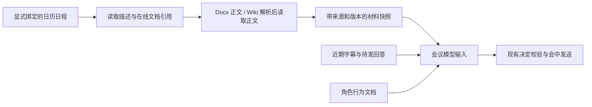

# 日历日程与在线文档上下文方案

日期：2026-10-14。状态：分析方案，等待用户确认；未修改产品代码，未调用真实日历/文档 API，也未读取真实资料。

用户已确认：资料来自飞书日历日程中的描述和附件；本次先处理飞书在线文档、知识库文档，上传的 Word / PDF 记录为后续 TODO 2.6。独立测试任务 2.3 取消，测试随各功能项进行；2.4 按用户确认标记完成。

## 可行性结论

日程描述、Docx 正文与 Wiki 节点解析都有官方接口，文本进入当前模型快照也有直接接入位置。首版技术可行，但尚不能承诺任意会议号都能自动找到对应日程，或日程 UI 中所有“附加文档”都已被现有 API 完整暴露。实际权限和在线文档引用的可取得性是前置验证点。

| 能力 | 已核实的公开契约 | 需要实际验证的部分 |
| --- | --- | --- |
| 日程描述 | 日历 get 返回 description，要求 calendar_id / event_id 及该日历 reader 或更高权限 | 当前应用能否读目标日历；个人日历可能需要用户 OAuth |
| 日程附件清单 | 返回附件 token、名称和大小等；创建接口使用 calendar 类型的素材上传 token | UI 里的在线文档/知识库引用具体出现在哪个字段，能否取得可解析 URL 或真实文档标识 |
| 新版在线文档 | Docx raw_content 返回纯文本；单独要求文档阅读权限 | 当前身份的实际文档 ACL、正文覆盖和大小 |
| 知识库文档 | get_node 返回底层对象 token 与类型，再调用相应正文接口 | 节点及底层文档权限；节点可能指向表格、文件等非文档对象 |
| 会议与日程对应 | 日程有视频会议链接；当前已核对的 VC join/get 未给出已确认的直接反查日程链路 | 重复会议号、重复日程实例、临时会议及同一会议链接被多个日程引用 |

## 推荐的首版边界

1. 显式绑定目标日历和日程实例，技术上使用 calendar_id / event_id；对照其会议链接和实际会话，拒绝明确不匹配的绑定。首版不扫描所有日历，不靠标题猜测，也不新增自动切会行为。日程分享链接能否稳定解析为这两个 ID，需验证后再承诺入口。
2. 读取日程描述，以及该日程明确关联的 Docx / Wiki 文档。Wiki 先解析实际对象，按实际类型读取；不将 Wiki 节点 token 或日程附件 token 直接传给 Docx 接口。首版以新版 Docx 及其 Wiki 节点为可确认范围，旧版 Doc、Sheet、Bitable 等发现后明确标记类型，未支持的类型不假装已读取。
3. 在 consume 启动时读取一次，形成当前会议的材料快照。每轮判断重用该快照，不每 0.7 秒抓全文；重启 consume 后重新读取。会中实时刷新、变化订阅、向量检索和自动摘要不默认加入首版，以保持范围可控。需要实时刷新时再单独确定刷新周期与失效规则。
4. 材料由产品程序通过飞书 API 读取，LLM 只接收整理后的背景文本；保持现有模型工具禁用，不让模型自行浏览日历、知识库或递归打开文档中的其他链接。
5. 上传的 Word / PDF 本次不下载、不解析；仅报告为未处理材料，后续在 2.6 实现。图片、复杂图表、表格应用也不承诺靠纯文本完整理解。

## 身份与权限

读取日程至少需要 calendar:calendar.event:read 等文档允许的读取 scope，同时当前身份对该日历应具有 reader / writer / owner 权限。仅开通 API scope 不等于可以读取个人日历。

读取 Docx 建议只申请 docx:document:readonly，并单独给调用身份文档阅读权限。Wiki 建议 wiki:node:read，并满足节点和底层文档的访问条件。能参加视频会议不代表能读取这些资料。

优先验证能否复用已有应用身份。若目标个人日历不能以应用身份获得读取权限，则需要为材料读取单独引入用户 OAuth、授权回调及 token 刷新/私有保存；现有入会、字幕与发送仍沿用应用身份，不改 VC 通路。不能为了复用应用 token，假定它能读用户所有日程；也不默认要求用户改用应用创建日程。

## 进入当前产品的方式

当前接入点是 AdviserStore.snapshot 与持久化模型任务快照。拟新增独立的 meeting_context 背景部分，包含来源标题/标识、对应日程实例、读取时间、实际类型、可用状态、正文及稳定内容版本。不改写 meeting_adviser.md，不把材料放到高优先级角色指令中。

- fresh_input_keys 继续只表示可行动的新鲜字幕。材料自身及加载完成不直接触发发言或暂停/恢复等控制。
- 新回答仍由当前字幕触发；reply_sentence_keys 继续关联字幕，文档作为回答依据的背景来源。
- 材料快照绑定实际 meeting_id、入会实例与日程实例，切会不沿用上场材料。
- 重启读到不同材料时，以正文/来源的稳定 hash 或可核实版本更新 context_version；读取时间不参与稳定 hash，避免每次重启被当作内容变化。
- 模型任务和待发回答记录所用 context_version。若恢复时版本已变化，待发候选重新检查；只改变材料不重新回答历史问题，也不清除已有暂停状态。
- 文档与会中说法不一致时，模型明确区分“材料记载”和“会中修正”，必要时澄清，不静默选择一个版本或自称掌握未读取内容。

首版加载不阻塞独立 collect 进程，设读取超时和数量/大小预算。配置了本项资料但尚未加载完成或读取失败时，明确显示状态并阻止新的模型回复，独立 collect 继续保存字幕；不把加载失败当作“材料为空”。未配置本项的旧配置继续沿用现有字幕模式。

## 主要风险与控制

| 风险 | 处理建议 |
| --- | --- |
| 读错日程或错用周会历史实例 | 显式绑定实例；结合会议链接/时间校对；不能唯一判断时不发送候选材料给模型 |
| 日历或文档不可读 | 首先核实读取身份和 ACL；明确报不可用；需要 OAuth 时作为实际范围增量说明 |
| 日程 UI 的在线文档关联没有从 API 返回 | 用一条获授权日程做只读核对；若没有可解析引用，停在此处说明限制。手工配置文档 URL 可以作为另议方案，不擅自把它算作已完成自动读取日程附件 |
| Wiki 对象类型不一致、正文抽取遗漏 | 先解析类型；纯文本不承诺图像和复杂表格语义；不支持或部分覆盖时明确标识 |
| 上下文过大、模型变慢 | 在现有上下文预算中为材料和近期字幕分配额度；优先保留近期字幕；超限明确报告范围，不无界拼全文，也不默认引入一次额外摘要模型调用 |
| 快照过时 | 首版明确为启动时快照，保留读取时间/版本；更新需重启；不声称会中实时同步 |
| 文档中的指令干扰角色 | 当作背景资料；不授予工具，不执行其中的暂停或对外发送要求，不递归抓取其他引用 |
| 新增资料保存与披露范围 | 缓存/模型任务/回复依据一起纳入私有存储、容量、保留与删除；权限撤销后的下次读取失败不继续沿用旧缓存；介绍说明扩展到描述及授权材料，不重新设独立审查任务 |

材料保存期限仍沿用当前产品策略；本机删除不能撤回会议消息或删除模型供应商侧数据。调用身份能读某篇文档，也不能直接推定全部参会者都应收到其全文，来源范围和输出规则须保持在会议授权用途内。

## 获得同意后的实施顺序

1. 用一条获授权日程核实：日历读取权限、线上文档/Wiki 引用在 API 中的实际表示、以及正文读取能力。只读验证不成功时先报告具体限制，不绕到抓取客户端或扩大读取范围。
2. 按确认的身份方案实现有界读取、类型识别和规范化材料快照。
3. 接入会议隔离的持久化与模型快照、恢复时的版本检查、状态和资料删除。
4. 在本项内验证权限不足、Wiki 解析、重复绑定、材料过大、会话切换、恢复和实际上下文使用；不另加独立测试阶段。每个完成的实施项按原约定验证并提交。

当前需要确认的方案取舍：首版显式绑定日程、启动时一次性读取、先覆盖 Docx 与 Wiki 文档；实际权限若要求 OAuth，再明确相应实现范围。尚未开始产品代码。

## 官方依据

- [获取日程](https://open.feishu.cn/document/server-docs/calendar-v4/calendar-event/get)：身份、日历访问权限、描述/附件及视频会议信息。
- [创建日程](https://open.feishu.cn/document/server-docs/calendar-v4/calendar-event/create)：日程附件使用 calendar 素材 token；不能当作 Docx ID。
- [获取 Docx 纯文本](https://open.feishu.cn/document/server-docs/docs/docs/docx-v1/document/raw_content)：正文读取及文档权限。
- [获取 Wiki 节点](https://open.feishu.cn/document/server-docs/docs/wiki-v2/space-node/get_node)：节点权限和底层对象 token / 类型。
- [获取在线文档信息](https://open.feishu.cn/document/server-docs/docs/docs/docx-v1/document/get)：标题和版本信息；纯文本读取与元数据获取应视实际接口能力配合，不伪造事务一致的远端快照。

本次仅核对公开接口契约，未验证目标租户权限或真实日程返回。方案中的可行性不等于实际接入已通过。
