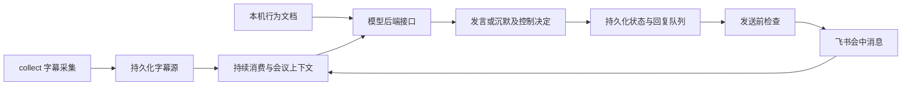

# 阶段 2.2：LLM 自主参与会议技术方案

日期：2026-10-14。状态：TODO 2.2 已实现并完成自动化故障验证与真实订阅合成调用；真实会议功能、展示和时延验收仍待 2.3。

首版采用 **Codex app-server + 用户已有订阅**，保留可替换的模型后端接口。产品负责采集、持久化、运行状态和飞书发送；Codex 根据行为文档与会议上下文决定是否发言、生成回答和识别自然语言控制意图。

交互决定以 [STAGE2_INTERACTION.md](STAGE2_INTERACTION.md) 为准；任务与验收状态见 [TODO.md](TODO.md)。本文记录方案及实际实现边界，验证证据与未覆盖项见 [STAGE2_VALIDATION.md](STAGE2_VALIDATION.md)。

## 1. 已确认的产品行为

- 不提供固定唤醒词或特殊控制指令，由 skill 或其他行为文档描述角色，LLM 自主判断是否需要发言。
- 在飞书会议内发送用户所称的 comment 文字，一次发完；使用已试通的 `bots/message` 会中消息接口及其展示位置。
- 普通暂停只暂停发言，继续采集、保存字幕并由 LLM 识别恢复意图；完整停止由主持人在终端停止采集和模型处理。
- 行为文档须描述发言/沉默边界、控制权限与要求冲突的处理方式；发送前检查问题撤回、结论修正、取消及暂停状态。
- 主持人在采集和模型处理前口头说明；bot 入会后发送一次简短介绍，说明作用、字幕保存及发送给配置的 LLM 处理等信息。
- 时延目标为提问说完至参会者看到首段有效回答，P95 ≤ 20 秒。一次发送完整消息时，终点是整条消息首次可见。先完成功能，再优化时延，20 秒暂不阻塞首版功能验收。
- 功能完成后由用户提供对话脚本，确定实际测试场次、样本和预期行为；不提前编造验收数字。

## 2. 当前可复用的实现

产品代码位于 `v2/src/feishu_meeting_adviser/`，不导入 `reference/spike/`。

- `collect` 持续读取字幕，完成规范化、持久化去重、分页与恢复，并默认在本机显示正文；`collect --no-text` 可关闭正文输出。
- SQLite 保存字幕、检查点、状态与独立的消费者进度；下游采用至少一次投递与幂等消费。
- `consume --backend codex --watch` 持续运行真实 LLM；省略 --watch 单次处理，--backend rule 独立保留固定测试规则。
- 会中消息客户端已经支持固定 UUID 和响应 UUID 核对；测试消费者已有持久化待发送回复与发送确认记录。
- 1.9 / G1 的真实会议回归仍待完成；固定规则成功发送不能替代输入完整性或正式问答验收。

固定截止日期规则保留为回归样例，避免与正式 LLM 同时对同一输入发言。

## 3. 总体架构



首版使用一个 LLM 完成参与判断和回答生成。采集、上下文、决策和发送职责明确，模型调用慢或失败不会阻止采集落盘。

运行入口沿用本机两个终端：终端 A 运行 `collect`，终端 B 运行 `consume --backend codex --watch`。配置未设置 llm 时使用 rule；两个后端不同时发言。

## 4. 模型后端与订阅接入

| 后端 | 接入方式 | 首版范围 |
| --- | --- | --- |
| 直接模型 API | Python 调用供应商 API，读取结构化决策与回复 | 保留适配接口，后续扩展 |
| Codex + 订阅 | Python 驱动本机 `codex app-server`，管理线程、轮次、结果事件和中断 | 首版采用 |
| OpenCode + 订阅 | Python 调用 `opencode serve` 的本地 HTTP 接口 | 可选后续后端 |

统一接口接收行为文档、会议上下文、新增或修订输入、参与状态及待发回答，返回结构化决定；供应商差异由适配器处理。

Codex 方案：

1. 使用 agent 自身支持的登录方式和用户已有订阅；先验证实际登录、所选模型访问及一次最小调用，不仅凭安装成功判断可用。
2. 启动本机 app-server，通过结构化协议建立线程并提交轮次，消费进度、完成、失败与中断事件。协议字段以安装版本的文档及生成 schema 核对。
3. 每次决定建立新的 ephemeral 线程，轮次完成后 unsubscribe；线程和轮次标识仅用于在途协议协调。产品数据库是字幕、参与状态、消费和回复的恢复依据，不能只依赖 agent 的上下文或自动摘要。
4. 明确轮次串行与中断行为，程序根据已持久化任务管理在途工作。失败或中断不能被当作成功回复。
5. agent 只返回决定和文本，飞书发送通过产品代码执行，以沿用 UUID、状态校验和去重。运行目录是私有空目录，禁用 shell、修改文件、Web、skills、hooks、记忆和插件；枚举继承的 MCP 服务并逐个禁用，在提交字幕前再次核对该线程没有暴露 MCP 工具，否则停止处理。启动覆盖只作用于子进程，不修改用户全局配置。

2026-10-14 本机检查结果：Codex CLI `0.162.0`、OpenCode `1.18.35` 已安装。已确认 ChatGPT 登录，并完成默认 gpt-6-astra 的一次合成空会议结构化调用，返回沉默；未读取真实会议资料。超时/中断与协议故障已有模拟测试，真实会议表现及额度边界仍待实测。

## 5. 行为文档与上下文

默认加载包内 `meeting_adviser.md`，可由 llm.role_file 指定的本机 Markdown 覆盖，描述：

- 会参谋的职责、可提供的帮助、何时补充/回答、何时沉默。
- 避免插话、重复别人已回答的内容或重复自身建议；依据不足时说明不确定性。
- 暂停、恢复、取消的自然语言含义与控制权限。
- 对普通讨论、引用、否定及互相矛盾的要求如何处理。

行为文档由本机维护。会议字幕作为输入资料提供，不能因一句发言就改写文档、扩大工具权限或增加资料访问范围。具体技能组织方式可以后续扩展，首版先使用一份角色文档。

每次决策的上下文包括：

- 行为文档及其版本。
- 带说话人、句子标识、时间和修订信息的近期字幕，以及本次新增/修订内容。
- 此前讨论的摘要（长会议时逐步引入），原始字幕保留以便核对和修正。
- bot 已实际发送的发言、待发送回答和发送结果。
- 当前参与状态、源状态与已知的内容缺口。

短时间内收到的字幕可合并成一批，再调用模型；没有新增或修订时不反复调用。默认等待 2 秒合批，正文预算 30000 字符、最多 1000 句，保留完整句子并标记省略；摘要尚未实现。新鲜度默认 120 秒、普通回复间隔默认 10 秒，均可配置；不按固定关键词筛选是否值得发言。

## 6. 结构化决定与控制

模型判断参与意图，程序校验并持久化结果。实际输出 schema：

```json
{
  "control": "none",
  "control_sentence_keys": [],
  "reply": null,
  "reply_sentence_keys": []
}
```

control 为 none / pause / resume / cancel；reply 为 null 时沉默，否则是一次发送的完整文字，最多 4000 UTF-8 字节。控制须引用本次新鲜字幕，回复须引用本次新鲜字幕或待发候选仍有效的依据。引用由程序核对会议、修订版本和新鲜度；pause / cancel 不得附普通回复。四个字段必填，不接受额外字段。

优先使用后端支持的结构化输出约束，并在本地校验类型、枚举、状态转换、说话人关联和权限。格式正确不代表内容正确；拒绝、截断、非法结果、失败或中断不得直接触发发送。

暂停期间仍调用模型识别控制意图，但程序不发送普通回复。完整停止不依赖 LLM 判断，由主持人的终端操作终止采集和模型处理。

用户已确认：任何参会者都可暂停、恢复或取消；无需配置主持人身份。模型通过字幕句子引用表达控制依据，程序核对这些引用属于本次有效输入。

## 7. 持久化、发送与过时检查

- 上下文、待处理任务、发言/沉默/控制决定和消费进度持久化；确认消费的时机必须保证输入已有可靠的处理结果或可恢复的待处理任务，不把读取或内存中的状态当作消费成功。
- 回复先进入持久化队列，再由发送模块执行。待发回复不能阻止后续字幕、暂停与取消意图被处理；这些意图仍需由 LLM 识别。
- 已保存的模型结果在重放时复用；同一输入/决策产生的回复使用固定 UUID，API 确认后保存发送状态。源进度和待发送/不确定回复分别可观察。
- 发送前检查参与状态、会议会话和最新已收到的字幕。如果生成期间出现新的相关内容，交给模型重新判断待发回答是否保留、修改或取消，避免仍发送撤回问题或旧结论的答案。
- 历史回补可补上下文，不能直接触发旧问题；不能仅按扫描模式判断新鲜度，也不能将缺失时间当作当前时间。
- 超时或异常返回保留不确定发送状态，先核对会中展示再重试，不盲目重新生成回答或改用新 UUID。服务端去重的有效范围仍待真实验证，不承诺 exactly-once。

发送前检查只能使用已到达的字幕，不能保证立即感知尚未被上游转写或送达的口头取消。实际控制响应时间需要对话测试验证。

## 8. 入会介绍、资料与可观测性

入会介绍使用固定产品文案，成功入会后发送一次，保存发送记录，重复 join 或进程重启不重复介绍；每次入会使用持久化 join_instance 去重，重新入会重新介绍。介绍未确认时先核对并 resolve-reply，模型处理暂不启动。

字幕、上下文、摘要、模型输入/输出、决策和待发回复视为会议资料。产品数据库纳入统一资料访问、保留及删除机制；agent 使用 ephemeral 线程，不保存会议会话副本；诊断只记录脱敏状态、耗时、错误类型和计数。显式删除覆盖 source、测试消费者和 adviser 数据库，不能将本机删除等同于撤回会中消息或删除供应商侧资料。

status 展示采集状态、模型后端与调用状态、active / paused、待决策和待发送数量、不确定发送数量。记录字幕接收、模型调用、决策保存和发送确认的时间，实际可见时间由用户现场测试标注。

## 9. 建议实现顺序

每项完成后验证并单独提交，具体拆分可在实施时细化：

1. 模型后端接口、Codex app-server 最小接入、行为文档与结构化结果校验。
2. 持续消费、会议上下文、线程隔离及可恢复的任务/状态。
3. LLM 发言/沉默决策与真实会中回复，固定规则作为独立回归样例。
4. 暂停/恢复/取消、控制身份与权限、在途任务和待发回复处理。
5. 最新上下文检查、过时回答处理、发送去重与异常恢复。
6. 入会介绍、模型/agent 资料保留与删除、状态和耗时观察。
7. 自动化故障验证，再使用用户提供的对话脚本进行真实功能验收；记录性能并后续优化。

## 10. 仍待实测的边界

- 用户功能测试脚本、预期发言/沉默与回答质量；真实会议展示和控制响应。
- 多场输入完整性、字幕修订与服务端 UUID 去重范围。
- 真实使用中的模型额度、网络失败、长会议上下文预算和性能优化。
- 模型发言意图和说话人关联的实际表现；模型输出格式正确不等于判断正确。

2.1 / 2.2 实现完成；1.9 / G1、2.3 / 2.4 / G2 仍待真实验证和审查。实现完成不等于阶段二已验收。

## 资料来源

- [Codex 认证](https://learn.chatgpt.com/docs/auth)：ChatGPT 订阅与 API key 两类登录方式。
- [Codex 集成方式](https://developers.openai.com/blog/codex-as-a-platform)：exec、SDK 和 app-server 的用途及产品集成边界。
- [Codex app-server](https://learn.chatgpt.com/docs/app-server)：会话、轮次、事件和程序控制协议。
- [结构化输出](https://developers.openai.com/api/docs/guides/structured-outputs)：模型输出 schema 约束及异常结果处理。
- [OpenCode Server](https://opencode.ai/docs/server/) 与 [Providers](https://opencode.ai/docs/providers/)：本地程序接口及供应商登录方式。
- [本项目会中输出核查](MEETING_OUTPUT_RESEARCH.md) 与 [字幕输入契约](TRANSCRIPT_SOURCE_CONTRACT.md)。

外部文档核查于 2026-10-14；文档支持不等于本机账号、安装版本或当前会议已验证。

## 实施记录

- 2.2.1 已实现：ModelBackend 协议、Codex app-server stdio 适配器、结构化决定校验、角色文档与可选本机覆盖、LLM 配置。6 项新增测试覆盖协议事件交错、失败/非法输出、工具请求、超时/停止与配置；累计 86 项产品测试通过。真实订阅仅验证合成空会议输入。
- 为避免在全局 Codex 会话目录中保存会议正文，每次决策使用新的 ephemeral 线程，完成后 unsubscribe；进程可复用，重启从产品数据库重建上下文，不依赖恢复 Codex 线程。模型不持有飞书发送职责。

- 2.2.2 已实现：独立 AdviserStore、可恢复输入/上下文/模型任务和 AdviserRunner 持续循环；模型在独立线程运行，源确认只在消费资料可靠保存后推进。输入确认丢失由持久化交付 ID 去重，模型错误低频恢复；新增 9 项合成测试通过。完整 CLI 与发送在下一分项接入。首版上下文保留有界的完整句子，显式标记省略；摘要压缩暂未引入，不将截取窗口表述为完整会议记忆。

- 2.2.3 已实现：consume 的 codex/rule 后端选择、--watch、结构化决定保存与独立 outbox；模型任务和发送结果各自持久化，未知 POST 结果进入 uncertain，后续字幕继续消费。新增 5 项测试通过；累计 100 项产品测试通过。单次消费处理当前输入，持续模式用于自动参与；真实飞书展示留待 2.3。

- 2.2.4 已完成自然语言控制的状态验证：暂停/恢复/取消决定关联当前有效字幕，任何参会者可控制；暂停时仍消费和调用模型，普通回复由程序抑制。新增 5 项测试通过。不确定 POST 需人工核对，cancel 不会伪称消息已撤回。

- 2.2.5 已实现：发送前检查源积压、会话/角色/配置/采集状态与有效证据，过期/修订候选取消；新字幕使候选等待模型重查。新增 replies / resolve-reply，发送结果不确定或明确拒绝后需停止 consume、核对会中 UI，再逐条确认 sent / retry / cancel。retry 保留 UUID 并重新判断最新讨论，不自动重发。新增 6 项测试通过。

- 2.2.6 已实现：配置 codex 时 join 发送固定介绍；首次模型消费可补介绍。介绍按持久化入会实例去重，失败/不确定时先人工核对。status 展示模型状态、参与状态、待处理输入和待发/不确定/拒绝回复；诊断不保存文本。模型资料加入显式删除与保留保护，运行消费时禁止删除；已完成模型任务压缩为决策/证据和输入快照摘要，不保留反复复制的完整 prompt。新增 8 项测试通过，累计 119 项产品测试通过。

- 2.2.7 已完成：整次调用期限含启动、RPC 与非阻塞写入；订阅认证核对；继承 MCP 逐项关闭及线程工具核对；SIGTERM / SIGKILL 恢复与 POST 后落盘前真实进程退出验证。真实订阅合成问题通过 AdviserRunner 生成回答并交给假飞书发送端，再运行无重复发送。操作与未覆盖项见验证记录。
